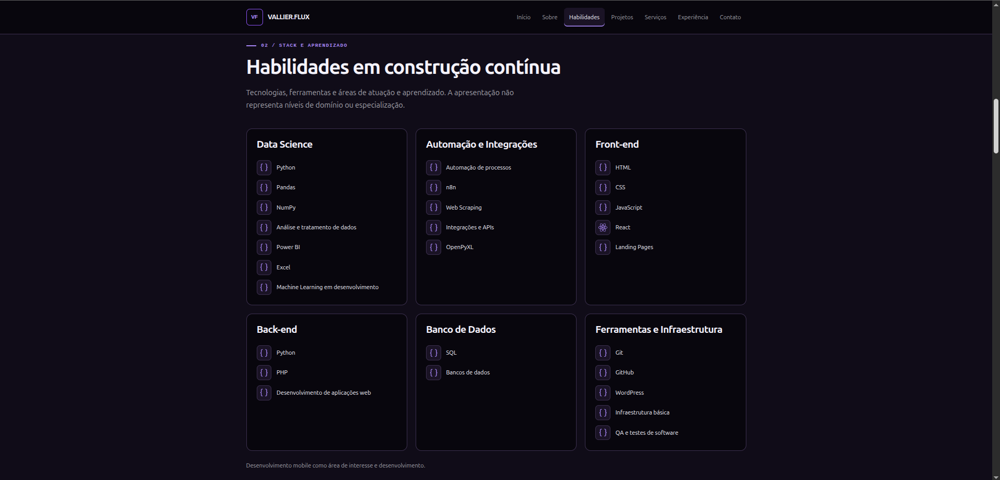

# VALLIER.FLUX

**CODE. DATA. AUTOMATION.**

Portfólio profissional de **Yohan Vallier**, com foco em Ciência de Dados, Automação e Desenvolvimento Full Stack. Construído com identidade visual própria em preto e roxo, conteúdo local tipado, pré-renderização estática (SSR no build) e foco em acessibilidade e performance.

## Prévia da Interface

### Início (Hero)


### Habilidades (Stack e Aprendizado)



## Visão Geral e Recursos

- **Identidade visual consistente**: design system próprio em CSS Modules com tokens em `src/styles/tokens.css`, tema escuro (`#08060D` / `#8B5CF6`) e suporte a `prefers-reduced-motion`.
- **Conteúdo desacoplado e tipado**: perfil, trajetória, habilidades, serviços e projetos organizados em `src/content/` sem necessidade de banco de dados ou backend próprio.
- **Pré-renderização no build (SSR)**: `scripts/prerender.ts` injeta o HTML semântico da página inicial em `dist/index.html` e gera `canonical`, `og:url`, `robots.txt` e `sitemap.xml` automaticamente quando `VITE_SITE_URL` está configurado.
- **Formulário de contato seguro**: validação local, campo honeypot oculto, timeout de 15 s, integração opcional via Formspree e estado seguro de configuração pendente com canais diretos ativos.
- **Qualidade automatizada**: TypeScript em modo estrito, ESLint sem tolerância a avisos, Prettier, Vitest + Testing Library, Playwright + axe-core (WCAG 2.2 AA) e Lighthouse CI.

## Stack Tecnológica

- **Interface**: React 19, TypeScript (strict), Vite 7, CSS Modules e Lucide React.
- **Contato (opcional)**: Formspree (`POST` JSON via HTTPS).
- **Testes e Qualidade**: Vitest, React Testing Library, Playwright, `@axe-core/playwright`, Lighthouse CI, ESLint e Prettier.
- **CI/CD e Hospedagem**: GitHub Actions (qualidade + deploy automático no GitHub Pages) e configuração de referência para Netlify (`netlify.toml`).

## Requisitos

- **Node.js**: versão indicada em `.nvmrc` (`22.14.0`, faixa aceita `>=22.14.0 <23`).
- **npm**: `10.9.2` (faixa aceita `>=10.9.2 <11`).

Com `nvm` instalado:

```sh
nvm install
nvm use
node --version
npm --version
```

## Instalação e Desenvolvimento

Na primeira instalação (caso ainda não tenha o `package-lock.json` gerado localmente):

```sh
npm install
cp .env.example .env.local
npm run dev
```

Depois de versionar o `package-lock.json`, prefira instalação reproduzível com `npm ci`. No Windows (PowerShell), use `Copy-Item .env.example .env.local`. Mantenha as variáveis vazias inicialmente e acesse `http://127.0.0.1:5173`.

Não versione `.env.local`. Reinicie o servidor após alterar variáveis de ambiente.

## Build e Preview

```sh
npm run build
npm run preview
```

O pipeline de build executa, em sequência:

1. `npm run typecheck` — verificação de tipos TypeScript (`tsc --noEmit`);
2. `npm run check:content` — validação estrutural da especificação e documentação obrigatória;
3. `vite build` — geração do bundle cliente em `dist/`;
4. `vite build --ssr src/entry-server.ts --outDir dist-ssr` — geração do bundle SSR;
5. `tsx scripts/prerender.ts` — pré-renderização do HTML inicial e metadados SEO em `dist/index.html`.

O preview local roda em **http://127.0.0.1:4173** com porta estrita.

## Comandos Disponíveis

| Comando | Finalidade |
| --- | --- |
| `npm run dev` | Iniciar servidor de desenvolvimento Vite (`127.0.0.1:5173`). |
| `npm run build` | Executar typecheck, validação de conteúdo, build cliente/SSR e pré-renderização. |
| `npm run preview` | Servir localmente o build de produção em `http://127.0.0.1:4173`. |
| `npm run lint` | Executar ESLint sem tolerância a avisos (`--max-warnings 0`). |
| `npm run typecheck` | Verificar TypeScript sem emitir arquivos. |
| `npm test` | Executar testes unitários e de componentes com Vitest. |
| `npm run test:watch` | Executar Vitest em modo interativo. |
| `npm run test:e2e` | Executar a suíte E2E com Playwright (Chromium, Firefox e WebKit). |
| `npm run test:a11y` | Executar os testes E2E de acessibilidade com axe-core. |
| `npm run audit:lighthouse` | Executar auditoria com Lighthouse CI. |
| `npm run check:content` | Validar integridade do conteúdo e arquivos obrigatórios. |
| `npm run verify:projects` | Consultar metadados públicos de repositórios no GitHub para revisão humana. |
| `npm run check:spec` | Verificar se `docs/project-spec.json` contém JSON válido. |
| `npm run format:check` | Conferir formatação Prettier sem alterar arquivos. |
| `npm run format` | Reformatar arquivos do projeto com Prettier. |

## Variáveis de Ambiente

Copie `.env.example` para `.env.local` no desenvolvimento local. Na hospedagem ou CI, configure as mesmas variáveis no ambiente de build.

| Variável | Descrição e comportamento |
| --- | --- |
| `VITE_BASE_PATH` | Caminho base da aplicação (padrão: `/`). Para GitHub Pages em repositório de projeto, use `/VALLIERFLUX/`. |
| `VITE_SITE_URL` | URL HTTPS pública definitiva (ex.: `https://seudominio.com`). Quando vazia, o build permanece `noindex, nofollow` e não emite `canonical`, `og:url` ou `sitemap.xml`. |
| `VITE_CONTACT_ENDPOINT` | Endpoint público opcional no formato `https://formspree.io/f/{id}`. Quando vazio, o formulário permanece visível e editável, com aviso persistente e botão de envio desabilitado. |

> **Atenção:** Toda variável com prefixo `VITE_` é incorporada ao bundle público do navegador. Nunca coloque tokens do GitHub, senhas, chaves privadas ou credenciais SMTP em variáveis `VITE_`.

## Estrutura do Projeto

```text
.
├── .github/workflows/      # Pipelines de CI (qualidade) e deploy (GitHub Pages)
├── docs/                   # Especificação, design system, privacidade e screenshots
├── public/                 # Assets públicos estáticos (favicon.svg)
├── scripts/                # Scripts de pré-renderização, validação e verificação GitHub
├── src/
│   ├── assets/             # Ícones locais e licenças
│   ├── components/         # Layout, seções, projetos, contato e primitivas de UI
│   ├── content/            # Dados tipados (site, profile, skills, services, projects)
│   ├── hooks/              # useActiveSection e useReveal
│   ├── lib/                # Validações puras de formulário e conteúdo
│   ├── services/           # Integração HTTP isolada com Formspree
│   ├── styles/             # Design tokens e estilos globais
│   └── types/              # Contratos TypeScript compartilhados
└── tests/                  # Testes unitários, de componentes e E2E (Playwright + axe)
```

## Personalização de Conteúdo

Os textos e dados do portfólio estão centralizados em módulos TypeScript tipados:

| Conteúdo | Arquivo |
| --- | --- |
| Marca, slogan, textos principais, navegação, links e SEO | `src/content/site.ts` |
| Apresentação pessoal, experiência e formação | `src/content/profile.ts` |
| Categorias e tecnologias | `src/content/skills.ts` |
| Serviços oferecidos | `src/content/services.ts` |
| Projetos em destaque e evidências | `src/content/projects.ts` |
| Paleta, tipografia, espaçamento e tokens | `src/styles/tokens.css` |
| Estilos globais, foco e acessibilidade | `src/styles/global.css` |
| Favicon VF | `public/favicon.svg` |

### Adicionando Projetos

Adicione novos itens em `src/content/projects.ts` seguindo a interface `Project` (`src/types/content.ts`). Cada `id` deve ser único e estável, `repositoryUrl` deve usar HTTPS e campos ainda não verificados devem permanecer `null` ou `[]` com `verificationStatus: 'pending'`.

```ts
{
  id: 'meu-projeto',
  name: 'MeuProjeto',
  repositoryUrl: 'https://github.com/YohanVallier/MeuProjeto',
  verificationStatus: 'pending',
  summary: null,
  problem: null,
  technologies: [],
  features: [],
  technicalHighlight: null,
  evidence: [
    {
      sourceType: 'user_context',
      sourceUrl: 'https://github.com/YohanVallier/MeuProjeto',
      commitSha: null,
      checkedAt: null,
      notes: 'Detalhes técnicos aguardando revisão.',
    },
  ],
}
```

Projetos atualmente listados:

- [DataForge](https://github.com/YohanVallier/DataForge)
- [AutomatedDataPipeline](https://github.com/YohanVallier/AutomatedDataPipeline)
- [BeaconOps](https://github.com/YohanVallier/BeaconOps)
- [VALLIERFLUX](https://github.com/YohanVallier/VALLIERFLUX)

## Formulário de Contato e Formspree

Sem `VITE_CONTACT_ENDPOINT` configurado, o formulário exibe um aviso persistente, mantém os campos editáveis e o botão de envio desabilitado, sem realizar chamadas de rede, enquanto e-mail, GitHub e LinkedIn permanecem disponíveis como canais diretos.

Para habilitar envios reais:

1. Crie o formulário na conta Formspree desejada e valide o destinatário.
2. Ative proteções antispam e limites no painel do provedor.
3. Revise a política de privacidade em `docs/privacy.md`.
4. Defina `VITE_CONTACT_ENDPOINT=https://formspree.io/f/{id}` no ambiente de build e gere um novo build.
5. Realize um envio real controlado para confirmar a entrega.

Em caso de abuso ou necessidade de desativação, revogue ou substitua o formulário diretamente no painel do Formspree e remova a variável do ambiente de build antes de republicar.

## Validação e Testes

```sh
npm install
cp .env.example .env.local
npm run check:spec
npm run check:content
npm run lint
npm run typecheck
npm run format:check
npm test
npm run build
npx playwright install --with-deps
npm run test:e2e
npm run test:a11y
npm run audit:lighthouse
```

## Publicação (Deploy)

### GitHub Pages

O workflow `.github/workflows/deploy.yml` publica automaticamente a branch `main` no GitHub Pages com `VITE_BASE_PATH='/VALLIERFLUX/'`.

### Netlify

O arquivo `netlify.toml` define o comando `npm run build`, diretório de saída `dist/`, cabeçalhos de segurança (`Content-Security-Policy`, `X-Frame-Options`, `X-Content-Type-Options`, `Referrer-Policy`, `Permissions-Policy`) e `X-Robots-Tag: noindex, nofollow` em deploy previews.

## Referências Internas

- `docs/project-spec.json` — especificação arquitetural e contratos.
- `docs/design-system.md` — sistema visual e diretrizes de interface.
- `docs/content-sources.md` — proveniência e atualização de conteúdo.
- `docs/privacy.md` — aviso de privacidade do formulário de contato.
