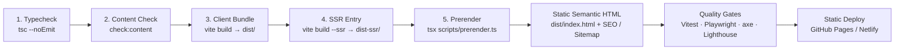
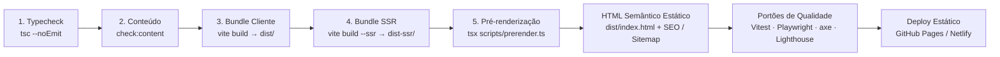

<a id="top"></a>

<div align="center">

# 🌐 VALLIER.FLUX

### CODE. DATA. AUTOMATION.

<a href="#english">
  <kbd>🇺🇸 English Version</kbd>
</a>
&nbsp;&nbsp;
<a href="#portugues">
  <kbd>🇧🇷 Versão em Português</kbd>
</a>
&nbsp;&nbsp;
<a href="https://yohanvallier.github.io/VALLIERFLUX/">
  <kbd>🚀 Live Portfolio</kbd>
</a>

<br/><br/>


<br/>

<kbd>⚛️ React 19</kbd>&nbsp;
<kbd>🔷 TypeScript 5.9 Strict</kbd>&nbsp;
<kbd>⚡ Vite 7 · SSR Prerender</kbd>&nbsp;
<kbd>🎨 CSS Modules & Tokens</kbd>&nbsp;
<kbd>♿ WCAG 2.2 AA</kbd>&nbsp;
<kbd>🚀 GitHub Pages + Netlify</kbd>

<br/><br/>


</div>

---

<a id="english"></a>

## 🇺🇸 English Documentation

> **CODE. DATA. AUTOMATION.** — The professional portfolio of **Yohan Vallier**, focused on **Data Science, Automation, and Full Stack Development**.

**VALLIER.FLUX** is built with a custom dark black-and-purple visual identity (`#08060D` / `#8B5CF6`), strictly typed local content, build-time SSR prerendering, and an automated quality pipeline covering unit tests, cross-browser E2E flows, WCAG 2.2 AA accessibility audits, and Lighthouse checks.

<div align="center">

[Preview](#en-preview) · [Features](#en-features) · [Architecture & Build](#en-architecture) · [Setup & Scripts](#en-setup) · [Env Vars](#en-env) · [Structure & Customization](#en-structure) · [Contact & Tests](#en-tests) · [Deploy](#en-deploy)

</div>

> [!IMPORTANT]
> **Architecture & Privacy Notice:** This application is **100% static** with no custom backend, database, or tracking cookies. All portfolio content lives in typed TypeScript modules (`src/content/`), `scripts/prerender.ts` outputs semantic HTML at build time, and the contact form remains safely disabled (`unconfigured` state) with direct channels active until a valid `VITE_CONTACT_ENDPOINT` (Formspree) is configured.

<a id="en-preview"></a>

### 🖼️ Interface Preview

<table>
  <tr>
    <td width="50%" align="center" valign="top">
      <strong>Home (Hero)</strong><br/><br/>
      
    </td>
    <td width="50%" align="center" valign="top">
      <strong>Skills (Stack & Learning)</strong><br/><br/>
      
    </td>
  </tr>
</table>

<a id="en-features"></a>

### ✨ Key Features & Tech Stack

<table>
  <tr>
    <td width="50%" valign="top">
      <h4>🎨 Custom Design System</h4>
      <ul>
        <li>Built with <strong>CSS Modules</strong> and CSS custom properties (<code>src/styles/tokens.css</code>).</li>
        <li>Dark tech theme (<code>#08060D</code> / <code>#8B5CF6</code>) responsive from <code>320px</code> upward.</li>
        <li>Full <code>prefers-reduced-motion</code> and keyboard focus support.</li>
      </ul>
    </td>
    <td width="50%" valign="top">
      <h4>📦 Typed Local Content</h4>
      <ul>
        <li>Profile, experience timeline, skills, services, and verified projects live in <code>src/content/</code>.</li>
        <li>Zero external CMS or runtime API dependencies.</li>
        <li>Automated content &amp; spec verification scripts.</li>
      </ul>
    </td>
  </tr>
  <tr>
    <td width="50%" valign="top">
      <h4>⚡ Build-Time SSR Prerendering</h4>
      <ul>
        <li><code>scripts/prerender.ts</code> injects semantic pre-rendered HTML into <code>dist/index.html</code>.</li>
        <li>Conditionally emits <code>canonical</code>, <code>og:url</code>, <code>robots.txt</code>, and <code>sitemap.xml</code> when <code>VITE_SITE_URL</code> is set.</li>
        <li>Defaults to <code>noindex, nofollow</code> on previews.</li>
      </ul>
    </td>
    <td width="50%" valign="top">
      <h4>🛡️ Safe Contact &amp; Quality Gates</h4>
      <ul>
        <li>Pure validation, hidden CSS honeypot, 15s timeout, optional Formspree integration, and permanent direct channels (email, GitHub, LinkedIn).</li>
        <li><strong>QA Suite:</strong> Strict TS, zero-warning ESLint, Prettier, Vitest + RTL, Playwright + <code>@axe-core/playwright</code> (WCAG 2.2 AA), and Lighthouse CI.</li>
      </ul>
    </td>
  </tr>
</table>

| Layer | Technologies |
| --- | --- |
| **Frontend** | `React 19` · `TypeScript 5.9 (strict)` · `Vite 7` · `CSS Modules` · `Lucide React` |
| **Optional Contact** | `Formspree` (`POST` JSON over HTTPS) |
| **Testing & Quality** | `Vitest` · `React Testing Library` · `Playwright` · `@axe-core/playwright` · `Lighthouse CI` · `ESLint` · `Prettier` |
| **CI/CD & Hosting** | `GitHub Actions` (QA + GitHub Pages deploy) · `Netlify` (`netlify.toml`) |

<a id="en-architecture"></a>

### 🏗️ 5-Step Build & SSR Prerender Pipeline



<a id="en-setup"></a>

### 🚀 Prerequisites, Installation & Build

> [!NOTE]
> **Runtime Requirements:** **Node.js** `22.14.0` (`.nvmrc`, supported `>=22.14.0 <23`) and **npm** `10.9.2` (`>=10.9.2 <11`).

<table>
  <tr>
    <td width="50%" valign="top">
      <h4>💻 Local Development</h4>

```sh
# Optional: align Node version via nvm
nvm install && nvm use

# First setup (generates package-lock.json)
# Use `npm ci` once lockfile is committed
npm install
cp .env.example .env.local
npm run dev
```

*Runs at `http://127.0.0.1:5173`. On Windows PowerShell use `Copy-Item .env.example .env.local`. Never commit `.env.local` and restart Vite after editing env vars.*
    </td>
    <td width="50%" valign="top">
      <h4>🏗️ Production Build &amp; Preview</h4>

```sh
# Runs typecheck, content check,
# client + SSR builds, and prerender
npm run build

# Serves dist/ on strict port 4173
npm run preview
```

*Local production preview is served at **`http://127.0.0.1:4173`**.*
    </td>
  </tr>
</table>

<details>
<summary><strong>📜 View All 15 Available npm Scripts (Click to expand)</strong></summary>

<br/>

| Command | Purpose |
| --- | --- |
| `npm run dev` | Start Vite development server (`127.0.0.1:5173`). |
| `npm run build` | Run typecheck, content check, client/SSR builds, and prerendering. |
| `npm run preview` | Serve the production build locally on port `4173`. |
| `npm run lint` | Run ESLint with zero warnings allowed (`--max-warnings 0`). |
| `npm run typecheck` | Run TypeScript type checking without emitting files. |
| `npm test` | Run unit and component tests with Vitest. |
| `npm run test:watch` | Run Vitest in interactive watch mode. |
| `npm run test:e2e` | Run Playwright E2E suite (Chromium, Firefox, WebKit). |
| `npm run test:a11y` | Run Playwright + axe-core accessibility tests. |
| `npm run audit:lighthouse` | Run Lighthouse CI audit against `dist/`. |
| `npm run check:content` | Validate local content and required documentation files. |
| `npm run verify:projects` | Query public GitHub repository metadata for human review. |
| `npm run check:spec` | Validate `docs/project-spec.json` syntax. |
| `npm run format:check` | Check Prettier formatting without modifying files. |
| `npm run format` | Format project files with Prettier. |

</details>

<a id="en-env"></a>

### 🔐 Environment Variables

Copy `.env.example` to `.env.local` for local development. For hosting or CI, configure the same variables in the build environment.

| Variable | Description &amp; Behavior |
| --- | --- |
| `VITE_BASE_PATH` | Application base path (default: `/`). Use `/VALLIERFLUX/` for GitHub Pages project deployments. |
| `VITE_SITE_URL` | Final public HTTPS URL (e.g., `https://yourdomain.com`). When empty, builds stay `noindex, nofollow` with no `canonical`, `og:url`, or `sitemap.xml`. |
| `VITE_CONTACT_ENDPOINT` | Optional public Formspree endpoint (`https://formspree.io/f/{id}`). When empty, inputs stay editable with a persistent notice and disabled submit button. |

> [!WARNING]
> **Security Note:** Every `VITE_` variable is embedded into the public client bundle. Never store GitHub tokens, passwords, private keys, or SMTP credentials in `VITE_` variables.

<a id="en-structure"></a>

### 📁 Project Structure & Content Customization

<details>
<summary><strong>📂 View Directory Tree &amp; Customization Map (Click to expand)</strong></summary>

```text
VALLIERFLUX/
├── .github/workflows/      # CI (quality) and CD (GitHub Pages deploy) pipelines
├── docs/                   # Architecture spec, design system, privacy policy, and screenshots
├── public/                 # Static public assets (favicon.svg)
├── scripts/                # Prerender, content validation, and GitHub verification scripts
├── src/
│   ├── assets/             # Local icons and licenses
│   ├── components/         # Layout, sections, projects, contact, and UI primitives
│   ├── content/            # Typed local content (site, profile, skills, services, projects)
│   ├── hooks/              # useActiveSection and useReveal
│   ├── lib/                # Pure form and content validation rules
│   ├── services/           # Isolated Formspree HTTP client
│   ├── styles/             # Design tokens and global styles
│   └── types/              # Shared TypeScript contracts
└── tests/                  # Unit, component, and E2E tests (Playwright + axe)
```

| Content | File |
| --- | --- |
| Brand, slogan, hero copy, navigation, links, SEO | `src/content/site.ts` |
| Bio, work experience, education | `src/content/profile.ts` |
| Skill categories and technologies | `src/content/skills.ts` |
| Services offered | `src/content/services.ts` |
| Featured projects and verification evidence | `src/content/projects.ts` |
| Palette, typography, spacing, tokens | `src/styles/tokens.css` |
| Global styles, focus states, accessibility | `src/styles/global.css` |
| VF favicon | `public/favicon.svg` |

**Internal Docs:** `docs/project-spec.json` (architecture & contracts) · `docs/design-system.md` (UI guidelines) · `docs/content-sources.md` (content provenance) · `docs/privacy.md` (contact privacy notice).

</details>

**Featured Repositories:** [DataForge](https://github.com/YohanVallier/DataForge) · [AutomatedDataPipeline](https://github.com/YohanVallier/AutomatedDataPipeline) · [BeaconOps](https://github.com/YohanVallier/BeaconOps) · [VALLIERFLUX](https://github.com/YohanVallier/VALLIERFLUX)

<a id="en-tests"></a>

### 🧪 Contact Form & Full Validation Suite

<table>
  <tr>
    <td width="50%" valign="top">
      <h4>✉️ Enabling Formspree</h4>
      <p>When <code>VITE_CONTACT_ENDPOINT</code> is empty, the form stays editable with a persistent notice, disables submit, and fires zero network requests while direct links remain active.</p>
      <ol>
        <li>Create a Formspree form and confirm the recipient address.</li>
        <li>Enable spam protection and rate limits in Formspree.</li>
        <li>Review the privacy notice in <code>docs/privacy.md</code>.</li>
        <li>Set <code>VITE_CONTACT_ENDPOINT=https://formspree.io/f/{id}</code> and rebuild.</li>
        <li>Run a controlled end-to-end test before going live.</li>
      </ol>
    </td>
    <td width="50%" valign="top">
      <h4>✅ Full Quality Pipeline</h4>

```sh
npm run check:spec
npm run check:content
npm run lint
npm run typecheck
npm run format:check
npm test
npm run build
npx playwright install --with-deps
npm run test:e2e
npm run test:a11y
npm run audit:lighthouse
```
    </td>
  </tr>
</table>

<a id="en-deploy"></a>

### ☁️ Deployment

<table>
  <tr>
    <td width="50%" valign="top">
      <h4>🐙 GitHub Pages</h4>
      <p><code>.github/workflows/deploy.yml</code> automatically builds and publishes <code>main</code> with <code>VITE_BASE_PATH='/VALLIERFLUX/'</code>.</p>
    </td>
    <td width="50%" valign="top">
      <h4>🌐 Netlify</h4>
      <p><code>netlify.toml</code> configures <code>npm run build</code>, <code>dist/</code> publishing, strict security headers (<code>CSP</code>, <code>X-Frame-Options</code>, <code>X-Content-Type-Options</code>, <code>Referrer-Policy</code>, <code>Permissions-Policy</code>), and <code>X-Robots-Tag: noindex, nofollow</code> on previews.</p>
    </td>
  </tr>
</table>

<div align="center">

<br/>

[⬆️ Back to top](#top) · [🇧🇷 Ir para a versão em Português](#portugues)

</div>

---

<a id="portugues"></a>

## 🇧🇷 Documentação em Português

> **CODE. DATA. AUTOMATION.** — O portfólio profissional de **Yohan Vallier**, com foco em **Ciência de Dados, Automação e Desenvolvimento Full Stack**.

O **VALLIER.FLUX** foi desenvolvido com identidade visual própria em preto e roxo (`#08060D` / `#8B5CF6`), conteúdo local estritamente tipado, pré-renderização estática (SSR no build) e um pipeline automatizado de qualidade cobrindo testes unitários, fluxos E2E multi-navegador, auditoria de acessibilidade WCAG 2.2 AA e Lighthouse CI.

<div align="center">

[Prévia](#pt-preview) · [Recursos](#pt-features) · [Arquitetura & Build](#pt-architecture) · [Instalação & Scripts](#pt-setup) · [Variáveis](#pt-env) · [Estrutura & Personalização](#pt-structure) · [Contato & Testes](#pt-tests) · [Deploy](#pt-deploy)

</div>

> [!IMPORTANT]
> **Arquitetura e Privacidade:** Esta aplicação é **100% estática**, sem backend próprio, banco de dados ou cookies de rastreamento. Todo o conteúdo reside em módulos TypeScript tipados (`src/content/`), `scripts/prerender.ts` gera HTML semântico no momento do build e o formulário permanece desabilitado de forma segura (`unconfigured`) com canais diretos ativos até que um `VITE_CONTACT_ENDPOINT` (Formspree) válido seja configurado.

<a id="pt-preview"></a>

### 🖼️ Prévia da Interface

<table>
  <tr>
    <td width="50%" align="center" valign="top">
      <strong>Início (Hero)</strong><br/><br/>
      
    </td>
    <td width="50%" align="center" valign="top">
      <strong>Habilidades (Stack e Aprendizado)</strong><br/><br/>
      
    </td>
  </tr>
</table>

<a id="pt-features"></a>

### ✨ Recursos Principais & Stack Tecnológica

<table>
  <tr>
    <td width="50%" valign="top">
      <h4>🎨 Design System Próprio</h4>
      <ul>
        <li>Construído com <strong>CSS Modules</strong> e variáveis CSS (<code>src/styles/tokens.css</code>).</li>
        <li>Tema escuro (<code>#08060D</code> / <code>#8B5CF6</code>) responsivo a partir de <code>320px</code>.</li>
        <li>Suporte completo a <code>prefers-reduced-motion</code> e navegação por teclado.</li>
      </ul>
    </td>
    <td width="50%" valign="top">
      <h4>📦 Conteúdo Local Tipado</h4>
      <ul>
        <li>Apresentação, trajetória, habilidades, serviços e projetos verificados em <code>src/content/</code>.</li>
        <li>Sem dependência de CMS externo ou chamadas de API em tempo de execução.</li>
        <li>Scripts automatizados de validação de conteúdo e especificação.</li>
      </ul>
    </td>
  </tr>
  <tr>
    <td width="50%" valign="top">
      <h4>⚡ Pré-renderização no Build (SSR)</h4>
      <ul>
        <li><code>scripts/prerender.ts</code> injeta o HTML semântico inicial em <code>dist/index.html</code>.</li>
        <li>Gera <code>canonical</code>, <code>og:url</code>, <code>robots.txt</code> e <code>sitemap.xml</code> quando <code>VITE_SITE_URL</code> está definido.</li>
        <li>Mantém <code>noindex, nofollow</code> por padrão em ambientes de preview.</li>
      </ul>
    </td>
    <td width="50%" valign="top">
      <h4>🛡️ Contato Seguro &amp; Qualidade</h4>
      <ul>
        <li>Validação pura dos campos, campo honeypot oculto via CSS, timeout de 15s, integração opcional com Formspree e canais diretos permanentes (e-mail, GitHub e LinkedIn).</li>
        <li><strong>Suíte de QA:</strong> TypeScript strict, ESLint sem avisos, Prettier, Vitest + RTL, Playwright + <code>@axe-core/playwright</code> (WCAG 2.2 AA) e Lighthouse CI.</li>
      </ul>
    </td>
  </tr>
</table>

| Camada | Tecnologias |
| --- | --- |
| **Interface** | `React 19` · `TypeScript 5.9 (strict)` · `Vite 7` · `CSS Modules` · `Lucide React` |
| **Contato (opcional)** | `Formspree` (`POST` JSON via HTTPS) |
| **Testes e Qualidade** | `Vitest` · `React Testing Library` · `Playwright` · `@axe-core/playwright` · `Lighthouse CI` · `ESLint` · `Prettier` |
| **CI/CD e Hospedagem** | `GitHub Actions` (qualidade + deploy no GitHub Pages) · `Netlify` (`netlify.toml`) |

<a id="pt-architecture"></a>

### 🏗️ Pipeline de Build e Pré-renderização SSR (5 Etapas)



<a id="pt-setup"></a>

### 🚀 Requisitos, Instalação e Build

> [!NOTE]
> **Requisitos de Ambiente:** **Node.js** `22.14.0` (`.nvmrc`, faixa aceita `>=22.14.0 <23`) e **npm** `10.9.2` (`>=10.9.2 <11`).

<table>
  <tr>
    <td width="50%" valign="top">
      <h4>💻 Desenvolvimento Local</h4>

```sh
# Opcional: alinhar versão do Node via nvm
nvm install && nvm use

# Primeira instalação (gera package-lock.json)
# Use `npm ci` após versionar o lockfile
npm install
cp .env.example .env.local
npm run dev
```

*Roda em `http://127.0.0.1:5173`. No Windows (PowerShell), use `Copy-Item .env.example .env.local`. Nunca versione `.env.local` e reinicie o servidor ao alterar variáveis.*
    </td>
    <td width="50%" valign="top">
      <h4>🏗️ Build de Produção e Preview</h4>

```sh
# Executa typecheck, validação de conteúdo,
# builds cliente/SSR e pré-renderização
npm run build

# Serve dist/ na porta estrita 4173
npm run preview
```

*O preview local de produção roda em **`http://127.0.0.1:4173`**.*
    </td>
  </tr>
</table>

<details>
<summary><strong>📜 Ver Todos os 15 Comandos npm Disponíveis (Clique para expandir)</strong></summary>

<br/>

| Comando | Finalidade |
| --- | --- |
| `npm run dev` | Iniciar servidor de desenvolvimento Vite (`127.0.0.1:5173`). |
| `npm run build` | Executar typecheck, validação de conteúdo, build cliente/SSR e pré-renderização. |
| `npm run preview` | Servir localmente o build de produção em `http://127.0.0.1:4173`. |
| `npm run lint` | Executar ESLint sem tolerância a avisos (`--max-warnings 0`). |
| `npm run typecheck` | Verificar TypeScript sem emitir arquivos. |
| `npm test` | Executar testes unitários e de componentes com Vitest. |
| `npm run test:watch` | Executar Vitest em modo interativo. |
| `npm run test:e2e` | Executar a suíte E2E com Playwright (Chromium, Firefox e WebKit). |
| `npm run test:a11y` | Executar os testes E2E de acessibilidade com axe-core. |
| `npm run audit:lighthouse` | Executar auditoria com Lighthouse CI. |
| `npm run check:content` | Validar integridade do conteúdo e arquivos obrigatórios. |
| `npm run verify:projects` | Consultar metadados públicos de repositórios no GitHub para revisão humana. |
| `npm run check:spec` | Verificar se `docs/project-spec.json` contém JSON válido. |
| `npm run format:check` | Conferir formatação Prettier sem alterar arquivos. |
| `npm run format` | Reformatar arquivos do projeto com Prettier. |

</details>

<a id="pt-env"></a>

### 🔐 Variáveis de Ambiente

Copie `.env.example` para `.env.local` no desenvolvimento local. Na hospedagem ou CI, configure as mesmas variáveis no ambiente de build.

| Variável | Descrição e comportamento |
| --- | --- |
| `VITE_BASE_PATH` | Caminho base da aplicação (padrão: `/`). Para GitHub Pages em repositório de projeto, use `/VALLIERFLUX/`. |
| `VITE_SITE_URL` | URL HTTPS pública definitiva (ex.: `https://seudominio.com`). Quando vazia, o build permanece `noindex, nofollow` e não emite `canonical`, `og:url` ou `sitemap.xml`. |
| `VITE_CONTACT_ENDPOINT` | Endpoint público opcional no formato `https://formspree.io/f/{id}`. Quando vazio, o formulário permanece visível e editável, com aviso persistente e botão de envio desabilitado. |

> [!WARNING]
> **Atenção:** Toda variável com prefixo `VITE_` é incorporada ao bundle público do navegador. Nunca coloque tokens do GitHub, senhas, chaves privadas ou credenciais SMTP em variáveis `VITE_`.

<a id="pt-structure"></a>

### 📁 Estrutura do Projeto e Personalização

<details>
<summary><strong>📂 Ver Árvore de Diretórios e Mapa de Personalização (Clique para expandir)</strong></summary>

```text
VALLIERFLUX/
├── .github/workflows/      # Pipelines de CI (qualidade) e deploy (GitHub Pages)
├── docs/                   # Especificação, design system, privacidade e screenshots
├── public/                 # Assets públicos estáticos (favicon.svg)
├── scripts/                # Scripts de pré-renderização, validação e verificação GitHub
├── src/
│   ├── assets/             # Ícones locais e licenças
│   ├── components/         # Layout, seções, projetos, contato e primitivas de UI
│   ├── content/            # Dados tipados (site, profile, skills, services, projects)
│   ├── hooks/              # useActiveSection e useReveal
│   ├── lib/                # Validações puras de formulário e conteúdo
│   ├── services/           # Integração HTTP isolada com Formspree
│   ├── styles/             # Design tokens e estilos globais
│   └── types/              # Contratos TypeScript compartilhados
└── tests/                  # Testes unitários, de componentes e E2E (Playwright + axe)
```

| Conteúdo | Arquivo |
| --- | --- |
| Marca, slogan, textos principais, navegação, links e SEO | `src/content/site.ts` |
| Apresentação pessoal, experiência e formação | `src/content/profile.ts` |
| Categorias e tecnologias | `src/content/skills.ts` |
| Serviços oferecidos | `src/content/services.ts` |
| Projetos em destaque e evidências | `src/content/projects.ts` |
| Paleta, tipografia, espaçamento e tokens | `src/styles/tokens.css` |
| Estilos globais, foco e acessibilidade | `src/styles/global.css` |
| Favicon VF | `public/favicon.svg` |

**Referências Internas:** `docs/project-spec.json` (especificação e contratos) · `docs/design-system.md` (diretrizes visuais) · `docs/content-sources.md` (proveniência de conteúdo) · `docs/privacy.md` (aviso de privacidade do contato).

</details>

**Repositórios em Destaque:** [DataForge](https://github.com/YohanVallier/DataForge) · [AutomatedDataPipeline](https://github.com/YohanVallier/AutomatedDataPipeline) · [BeaconOps](https://github.com/YohanVallier/BeaconOps) · [VALLIERFLUX](https://github.com/YohanVallier/VALLIERFLUX)

<a id="pt-tests"></a>

### 🧪 Formulário de Contato e Suíte de Validação

<table>
  <tr>
    <td width="50%" valign="top">
      <h4>✉️ Habilitando o Formspree</h4>
      <p>Sem <code>VITE_CONTACT_ENDPOINT</code> configurado, o formulário mantém os campos editáveis com aviso persistente, desabilita o envio e não realiza chamadas de rede, mantendo os canais diretos ativos.</p>
      <ol>
        <li>Crie o formulário na conta Formspree e valide o destinatário.</li>
        <li>Ative proteções antispam e limites no painel do provedor.</li>
        <li>Revise a política de privacidade em <code>docs/privacy.md</code>.</li>
        <li>Defina <code>VITE_CONTACT_ENDPOINT=https://formspree.io/f/{id}</code> e gere um novo build.</li>
        <li>Realize um envio real controlado para confirmar a entrega.</li>
      </ol>
    </td>
    <td width="50%" valign="top">
      <h4>✅ Pipeline Completo de Qualidade</h4>

```sh
npm run check:spec
npm run check:content
npm run lint
npm run typecheck
npm run format:check
npm test
npm run build
npx playwright install --with-deps
npm run test:e2e
npm run test:a11y
npm run audit:lighthouse
```
    </td>
  </tr>
</table>

<a id="pt-deploy"></a>

### ☁️ Publicação (Deploy)

<table>
  <tr>
    <td width="50%" valign="top">
      <h4>🐙 GitHub Pages</h4>
      <p>O workflow <code>.github/workflows/deploy.yml</code> publica automaticamente a branch <code>main</code> no GitHub Pages com <code>VITE_BASE_PATH='/VALLIERFLUX/'</code>.</p>
    </td>
    <td width="50%" valign="top">
      <h4>🌐 Netlify</h4>
      <p>O arquivo <code>netlify.toml</code> define <code>npm run build</code>, publicação de <code>dist/</code>, cabeçalhos de segurança (<code>CSP</code>, <code>X-Frame-Options</code>, <code>X-Content-Type-Options</code>, <code>Referrer-Policy</code>, <code>Permissions-Policy</code>) e <code>X-Robots-Tag: noindex, nofollow</code> em previews.</p>
    </td>
  </tr>
</table>

<div align="center">

<br/>

[⬆️ Voltar ao topo](#top) · [🇺🇸 Switch to English](#english)

</div>