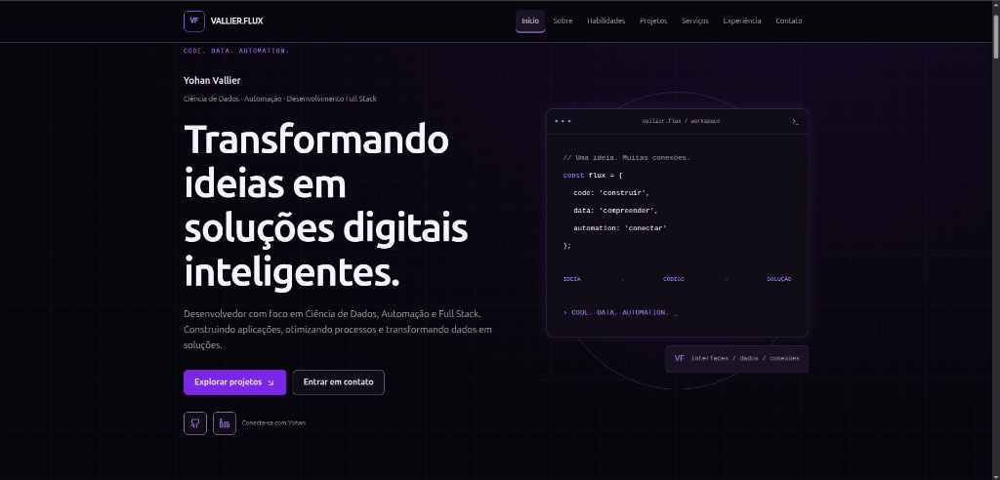

<div align="center">

<h1>VALLIER.FLUX — Professional Portfolio (React 19 + TypeScript + Vite 7)</h1>

<p>
  
  
  
  
</p>

<p>
  
  
  
</p>

<p><strong>CODE. DATA. AUTOMATION.</strong></p>

<p>
  <strong>Language / Idioma:</strong>
  <a href="#english">English</a> | <a href="#português-brasil">Português (Brasil)</a>
</p>

</div>

---

## English

### Overview

**VALLIER.FLUX** is the professional portfolio of **Yohan Vallier**, focused on **Data Science, Automation, and Full Stack Development**. Built with a dark black-and-purple visual identity, strictly typed local content, build-time SSR prerendering, and an automated quality pipeline covering unit tests, cross-browser E2E flows, accessibility audits, and Lighthouse checks.

> **Architecture & Privacy Notice:** This application is **100% static** with no custom backend, database, or tracking cookies. All portfolio content lives in typed TypeScript modules (`src/content/`), `scripts/prerender.ts` outputs semantic HTML at build time, and the contact form remains safely disabled (`unconfigured` state) with direct channels active until a valid `VITE_CONTACT_ENDPOINT` (Formspree) is configured.

### Interface Preview

**Home (Hero)**



**Skills (Stack & Learning)**


### Key Features

- **Custom Design System**: Built with CSS Modules and CSS custom properties (`src/styles/tokens.css`), dark theme (`#08060D` / `#8B5CF6`), responsive layout from `320px` upward, and full `prefers-reduced-motion` support.
- **Typed Local Content**: Profile, experience timeline, skills, services, and verified projects live in `src/content/` without external CMS or runtime API dependencies.
- **Build-Time SSR Prerendering**: `scripts/prerender.ts` injects pre-rendered HTML into `dist/index.html` and conditionally emits `canonical`, `og:url`, `robots.txt`, and `sitemap.xml` when `VITE_SITE_URL` is configured (defaulting to `noindex, nofollow` on previews).
- **Accessible & Safe Contact Flow**: Pure payload validation, hidden CSS honeypot field, 15-second request timeout, optional Formspree integration, and persistent direct channels (email, GitHub, LinkedIn).
- **Automated Quality Gates**: Strict TypeScript, zero-warning ESLint, Prettier, Vitest + React Testing Library, Playwright + `@axe-core/playwright` (WCAG 2.2 AA), and Lighthouse CI.

### Tech Stack

- **Frontend**: React 19, TypeScript (strict mode), Vite 7, CSS Modules, Lucide React.
- **Optional Contact Integration**: Formspree (`POST` JSON over HTTPS).
- **Testing & Quality**: Vitest, React Testing Library, Playwright, `@axe-core/playwright`, Lighthouse CI, ESLint, Prettier.
- **CI/CD & Hosting**: GitHub Actions (quality checks + automated GitHub Pages deployment) and Netlify reference config (`netlify.toml`).

### Prerequisites

- **Node.js**: version specified in `.nvmrc` (`22.14.0`, supported range `>=22.14.0 <23`).
- **npm**: `10.9.2` (supported range `>=10.9.2 <11`).

With `nvm` installed:

```sh
nvm install
nvm use
node --version
npm --version
```

### Installation & Development

On first setup (to generate `package-lock.json` locally):

```sh
npm install
cp .env.example .env.local
npm run dev
```

Once `package-lock.json` is committed, use `npm ci` for reproducible installs. On Windows PowerShell, use `Copy-Item .env.example .env.local`. Keep environment variables empty initially and open `http://127.0.0.1:5173`.

Never commit `.env.local`. Restart the dev server after changing environment variables.

### Build & Preview

```sh
npm run build
npm run preview
```

The build pipeline executes five steps in sequence:

1. `npm run typecheck` — strict TypeScript check (`tsc --noEmit`);
2. `npm run check:content` — validates specification integrity and required docs;
3. `vite build` — generates the client bundle in `dist/`;
4. `vite build --ssr src/entry-server.ts --outDir dist-ssr` — builds the SSR entry;
5. `tsx scripts/prerender.ts` — pre-renders initial HTML and SEO metadata into `dist/index.html`.

Local preview serves the production build at **http://127.0.0.1:4173** (strict port).

### Available Scripts

| Command | Purpose |
| --- | --- |
| `npm run dev` | Start Vite development server (`127.0.0.1:5173`). |
| `npm run build` | Run typecheck, content check, client/SSR builds, and prerendering. |
| `npm run preview` | Serve the production build locally on port `4173`. |
| `npm run lint` | Run ESLint with zero warnings allowed (`--max-warnings 0`). |
| `npm run typecheck` | Run TypeScript type checking without emitting files. |
| `npm test` | Run unit and component tests with Vitest. |
| `npm run test:watch` | Run Vitest in interactive watch mode. |
| `npm run test:e2e` | Run Playwright E2E suite (Chromium, Firefox, WebKit). |
| `npm run test:a11y` | Run Playwright + axe-core accessibility tests. |
| `npm run audit:lighthouse` | Run Lighthouse CI audit against `dist/`. |
| `npm run check:content` | Validate local content and required documentation files. |
| `npm run verify:projects` | Query public GitHub repository metadata for human review. |
| `npm run check:spec` | Validate `docs/project-spec.json` syntax. |
| `npm run format:check` | Check Prettier formatting without modifying files. |
| `npm run format` | Format project files with Prettier. |

### Environment Variables

Copy `.env.example` to `.env.local` for local development. For hosting or CI, configure the same variables in the build environment.

| Variable | Description & Behavior |
| --- | --- |
| `VITE_BASE_PATH` | Application base path (default: `/`). Use `/VALLIERFLUX/` for GitHub Pages project deployments. |
| `VITE_SITE_URL` | Final public HTTPS URL (e.g., `https://yourdomain.com`). When empty, builds stay `noindex, nofollow` with no `canonical`, `og:url`, or `sitemap.xml`. |
| `VITE_CONTACT_ENDPOINT` | Optional public Formspree endpoint (`https://formspree.io/f/{id}`). When empty, inputs stay editable with a persistent notice and disabled submit button. |

> **Security Note:** Every `VITE_` variable is embedded into the public client bundle. Never store GitHub tokens, passwords, private keys, or SMTP credentials in `VITE_` variables.

### Project Structure

```text
.
├── .github/workflows/      # CI (quality) and CD (GitHub Pages deploy) pipelines
├── docs/                   # Architecture spec, design system, privacy policy, and screenshots
├── public/                 # Static public assets (favicon.svg)
├── scripts/                # Prerender, content validation, and GitHub verification scripts
├── src/
│   ├── assets/             # Local icons and licenses
│   ├── components/         # Layout, sections, projects, contact, and UI primitives
│   ├── content/            # Typed local content (site, profile, skills, services, projects)
│   ├── hooks/              # useActiveSection and useReveal
│   ├── lib/                # Pure form and content validation rules
│   ├── services/           # Isolated Formspree HTTP client
│   ├── styles/             # Design tokens and global styles
│   └── types/              # Shared TypeScript contracts
└── tests/                  # Unit, component, and E2E tests (Playwright + axe)
```

### Content Customization

| Content | File |
| --- | --- |
| Brand, slogan, hero copy, navigation, links, SEO | `src/content/site.ts` |
| Bio, work experience, education | `src/content/profile.ts` |
| Skill categories and technologies | `src/content/skills.ts` |
| Services offered | `src/content/services.ts` |
| Featured projects and verification evidence | `src/content/projects.ts` |
| Palette, typography, spacing, tokens | `src/styles/tokens.css` |
| Global styles, focus states, accessibility | `src/styles/global.css` |
| VF favicon | `public/favicon.svg` |

**Featured Repositories:**

- [DataForge](https://github.com/YohanVallier/DataForge)
- [AutomatedDataPipeline](https://github.com/YohanVallier/AutomatedDataPipeline)
- [BeaconOps](https://github.com/YohanVallier/BeaconOps)
- [VALLIERFLUX](https://github.com/YohanVallier/VALLIERFLUX)

### Contact Form & Formspree

When `VITE_CONTACT_ENDPOINT` is empty, the form shows a persistent pending-configuration notice, keeps inputs editable, disables submission, and fires zero network requests while keeping email, GitHub, and LinkedIn active.

To enable live submissions:

1. Create a Formspree form in the target account and confirm the recipient address.
2. Enable spam protection and rate limits in the Formspree dashboard.
3. Review the privacy notice in `docs/privacy.md`.
4. Set `VITE_CONTACT_ENDPOINT=https://formspree.io/f/{id}` in the build environment and rebuild.
5. Run a controlled end-to-end verification before publishing to production.

### Validation & Tests

```sh
npm install
cp .env.example .env.local
npm run check:spec
npm run check:content
npm run lint
npm run typecheck
npm run format:check
npm test
npm run build
npx playwright install --with-deps
npm run test:e2e
npm run test:a11y
npm run audit:lighthouse
```

### Deployment

- **GitHub Pages**: `.github/workflows/deploy.yml` builds and publishes `main` automatically with `VITE_BASE_PATH='/VALLIERFLUX/'`.
- **Netlify**: `netlify.toml` configures `npm run build`, `dist/` publishing, security headers (`Content-Security-Policy`, `X-Frame-Options`, `X-Content-Type-Options`, `Referrer-Policy`, `Permissions-Policy`), and `X-Robots-Tag: noindex, nofollow` on deploy previews.

### Internal References

- `docs/project-spec.json` — architecture specification and contracts.
- `docs/design-system.md` — visual system and UI guidelines.
- `docs/content-sources.md` — content provenance and update workflow.
- `docs/privacy.md` — contact form privacy notice.

---

## Português (Brasil)

### Visão Geral

**VALLIER.FLUX** é o portfólio profissional de **Yohan Vallier**, com foco em **Ciência de Dados, Automação e Desenvolvimento Full Stack**. Desenvolvido com identidade visual própria em preto e roxo, conteúdo local tipado, pré-renderização estática (SSR no build) e pipeline automatizado de qualidade com testes unitários, E2E multi-navegador, acessibilidade e Lighthouse.

> **Arquitetura e Privacidade:** Esta aplicação é **100% estática**, sem backend próprio, banco de dados ou cookies de rastreamento. Todo o conteúdo reside em módulos TypeScript tipados (`src/content/`), `scripts/prerender.ts` gera HTML semântico no momento do build e o formulário permanece desabilitado de forma segura (`unconfigured`) com canais diretos ativos até que um `VITE_CONTACT_ENDPOINT` (Formspree) válido seja configurado.

### Prévia da Interface

**Início (Hero)**


**Habilidades (Stack e Aprendizado)**


### Recursos Principais

- **Design System Próprio**: construído com CSS Modules e variáveis CSS (`src/styles/tokens.css`), tema escuro (`#08060D` / `#8B5CF6`), layout responsivo a partir de `320px` e suporte a `prefers-reduced-motion`.
- **Conteúdo Local Tipado**: apresentação, trajetória, habilidades, serviços e projetos verificados organizados em `src/content/`, sem dependência de CMS externo ou chamadas de API em tempo de execução.
- **Pré-renderização no Build (SSR)**: `scripts/prerender.ts` injeta o HTML semântico da página inicial em `dist/index.html` e gera `canonical`, `og:url`, `robots.txt` e `sitemap.xml` automaticamente quando `VITE_SITE_URL` está definido (mantendo `noindex, nofollow` em previews).
- **Contato Seguro e Acessível**: validação pura dos campos, campo honeypot oculto via CSS, timeout de 15 segundos, integração opcional com Formspree e canais diretos permanentes (e-mail, GitHub e LinkedIn).
- **Qualidade Automatizada**: TypeScript em modo estrito, ESLint sem tolerância a avisos, Prettier, Vitest + React Testing Library, Playwright + `@axe-core/playwright` (WCAG 2.2 AA) e Lighthouse CI.

### Stack Tecnológica

- **Interface**: React 19, TypeScript (strict), Vite 7, CSS Modules e Lucide React.
- **Contato (opcional)**: Formspree (`POST` JSON via HTTPS).
- **Testes e Qualidade**: Vitest, React Testing Library, Playwright, `@axe-core/playwright`, Lighthouse CI, ESLint e Prettier.
- **CI/CD e Hospedagem**: GitHub Actions (qualidade + deploy automático no GitHub Pages) e configuração de referência para Netlify (`netlify.toml`).

### Requisitos

- **Node.js**: versão indicada em `.nvmrc` (`22.14.0`, faixa aceita `>=22.14.0 <23`).
- **npm**: `10.9.2` (faixa aceita `>=10.9.2 <11`).

Com `nvm` instalado:

```sh
nvm install
nvm use
node --version
npm --version
```

### Instalação e Desenvolvimento

Na primeira instalação (para gerar o `package-lock.json` localmente):

```sh
npm install
cp .env.example .env.local
npm run dev
```

Depois de versionar o `package-lock.json`, prefira instalação reproduzível com `npm ci`. No Windows (PowerShell), use `Copy-Item .env.example .env.local`. Mantenha as variáveis vazias inicialmente e acesse `http://127.0.0.1:5173`.

Não versione `.env.local`. Reinicie o servidor após alterar variáveis de ambiente.

### Build e Preview

```sh
npm run build
npm run preview
```

O pipeline de build executa, em sequência:

1. `npm run typecheck` — verificação de tipos TypeScript (`tsc --noEmit`);
2. `npm run check:content` — validação estrutural da especificação e documentação obrigatória;
3. `vite build` — geração do bundle cliente em `dist/`;
4. `vite build --ssr src/entry-server.ts --outDir dist-ssr` — geração do bundle SSR;
5. `tsx scripts/prerender.ts` — pré-renderização do HTML inicial e metadados SEO em `dist/index.html`.

O preview local roda em **http://127.0.0.1:4173** com porta estrita.

### Comandos Disponíveis

| Comando | Finalidade |
| --- | --- |
| `npm run dev` | Iniciar servidor de desenvolvimento Vite (`127.0.0.1:5173`). |
| `npm run build` | Executar typecheck, validação de conteúdo, build cliente/SSR e pré-renderização. |
| `npm run preview` | Servir localmente o build de produção em `http://127.0.0.1:4173`. |
| `npm run lint` | Executar ESLint sem tolerância a avisos (`--max-warnings 0`). |
| `npm run typecheck` | Verificar TypeScript sem emitir arquivos. |
| `npm test` | Executar testes unitários e de componentes com Vitest. |
| `npm run test:watch` | Executar Vitest em modo interativo. |
| `npm run test:e2e` | Executar a suíte E2E com Playwright (Chromium, Firefox e WebKit). |
| `npm run test:a11y` | Executar os testes E2E de acessibilidade com axe-core. |
| `npm run audit:lighthouse` | Executar auditoria com Lighthouse CI. |
| `npm run check:content` | Validar integridade do conteúdo e arquivos obrigatórios. |
| `npm run verify:projects` | Consultar metadados públicos de repositórios no GitHub para revisão humana. |
| `npm run check:spec` | Verificar se `docs/project-spec.json` contém JSON válido. |
| `npm run format:check` | Conferir formatação Prettier sem alterar arquivos. |
| `npm run format` | Reformatar arquivos do projeto com Prettier. |

### Variáveis de Ambiente

Copie `.env.example` para `.env.local` no desenvolvimento local. Na hospedagem ou CI, configure as mesmas variáveis no ambiente de build.

| Variável | Descrição e comportamento |
| --- | --- |
| `VITE_BASE_PATH` | Caminho base da aplicação (padrão: `/`). Para GitHub Pages em repositório de projeto, use `/VALLIERFLUX/`. |
| `VITE_SITE_URL` | URL HTTPS pública definitiva (ex.: `https://seudominio.com`). Quando vazia, o build permanece `noindex, nofollow` e não emite `canonical`, `og:url` ou `sitemap.xml`. |
| `VITE_CONTACT_ENDPOINT` | Endpoint público opcional no formato `https://formspree.io/f/{id}`. Quando vazio, o formulário permanece visível e editável, com aviso persistente e botão de envio desabilitado. |

> **Atenção:** Toda variável com prefixo `VITE_` é incorporada ao bundle público do navegador. Nunca coloque tokens do GitHub, senhas, chaves privadas ou credenciais SMTP em variáveis `VITE_`.

### Estrutura do Projeto

```text
.
├── .github/workflows/      # Pipelines de CI (qualidade) e deploy (GitHub Pages)
├── docs/                   # Especificação, design system, privacidade e screenshots
├── public/                 # Assets públicos estáticos (favicon.svg)
├── scripts/                # Scripts de pré-renderização, validação e verificação GitHub
├── src/
│   ├── assets/             # Ícones locais e licenças
│   ├── components/         # Layout, seções, projetos, contato e primitivas de UI
│   ├── content/            # Dados tipados (site, profile, skills, services, projects)
│   ├── hooks/              # useActiveSection e useReveal
│   ├── lib/                # Validações puras de formulário e conteúdo
│   ├── services/           # Integração HTTP isolada com Formspree
│   ├── styles/             # Design tokens e estilos globais
│   └── types/              # Contratos TypeScript compartilhados
└── tests/                  # Testes unitários, de componentes e E2E (Playwright + axe)
```

### Personalização de Conteúdo

| Conteúdo | Arquivo |
| --- | --- |
| Marca, slogan, textos principais, navegação, links e SEO | `src/content/site.ts` |
| Apresentação pessoal, experiência e formação | `src/content/profile.ts` |
| Categorias e tecnologias | `src/content/skills.ts` |
| Serviços oferecidos | `src/content/services.ts` |
| Projetos em destaque e evidências | `src/content/projects.ts` |
| Paleta, tipografia, espaçamento e tokens | `src/styles/tokens.css` |
| Estilos globais, foco e acessibilidade | `src/styles/global.css` |
| Favicon VF | `public/favicon.svg` |

**Repositórios em Destaque:**

- [DataForge](https://github.com/YohanVallier/DataForge)
- [AutomatedDataPipeline](https://github.com/YohanVallier/AutomatedDataPipeline)
- [BeaconOps](https://github.com/YohanVallier/BeaconOps)
- [VALLIERFLUX](https://github.com/YohanVallier/VALLIERFLUX)

### Formulário de Contato e Formspree

Sem `VITE_CONTACT_ENDPOINT` configurado, o formulário exibe um aviso persistente, mantém os campos editáveis e o botão de envio desabilitado, sem realizar chamadas de rede, enquanto e-mail, GitHub e LinkedIn permanecem disponíveis como canais diretos.

Para habilitar envios reais:

1. Crie o formulário na conta Formspree desejada e valide o destinatário.
2. Ative proteções antispam e limites no painel do provedor.
3. Revise a política de privacidade em `docs/privacy.md`.
4. Defina `VITE_CONTACT_ENDPOINT=https://formspree.io/f/{id}` no ambiente de build e gere um novo build.
5. Realize um envio real controlado para confirmar a entrega.

### Validação e Testes

```sh
npm install
cp .env.example .env.local
npm run check:spec
npm run check:content
npm run lint
npm run typecheck
npm run format:check
npm test
npm run build
npx playwright install --with-deps
npm run test:e2e
npm run test:a11y
npm run audit:lighthouse
```

### Publicação (Deploy)

- **GitHub Pages**: o workflow `.github/workflows/deploy.yml` publica automaticamente a branch `main` no GitHub Pages com `VITE_BASE_PATH='/VALLIERFLUX/'`.
- **Netlify**: o arquivo `netlify.toml` define o comando `npm run build`, diretório de saída `dist/`, cabeçalhos de segurança (`Content-Security-Policy`, `X-Frame-Options`, `X-Content-Type-Options`, `Referrer-Policy`, `Permissions-Policy`) e `X-Robots-Tag: noindex, nofollow` em deploy previews.

### Referências Internas

- `docs/project-spec.json` — especificação arquitetural e contratos.
- `docs/design-system.md` — sistema visual e diretrizes de interface.
- `docs/content-sources.md` — proveniência e atualização de conteúdo.
- `docs/privacy.md` — aviso de privacidade do formulário de contato.
